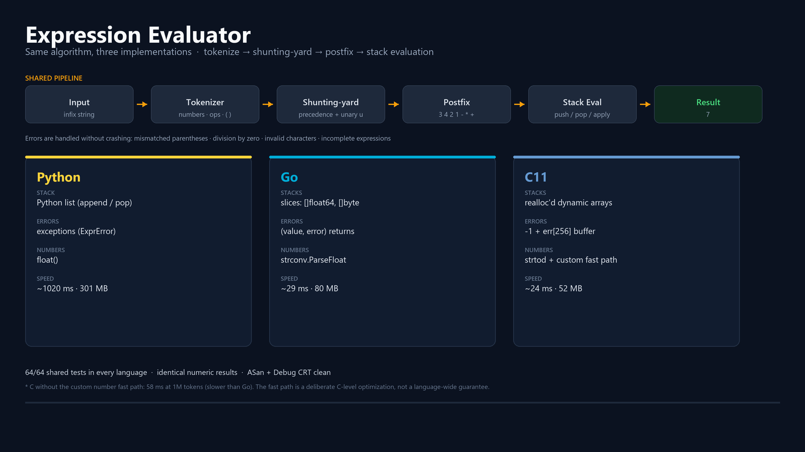

# ارزیابی عبارات ریاضی با استفاده از استک

پیاده‌سازی الگوریتم «ارزیابی عبارت با استک» در سه زبان **Python 3**، **Go** و **C11**؛ هر سه کاملاً قابل اجرا، تست‌شده و بنچمارک‌شده‌اند.

---

## ۱. مقدمه: مسئله چیست و چرا استک؟

یک عبارت ریاضی به شکل **infix** (میان‌وندی) نوشته می‌شود؛ مثل `3 + 4 * (2 - 1)`. برای انسان خواناست، اما برای ماشین مبهم است: ترتیب اجرا به اولویت عملگرها و پرانتزها بستگی دارد و اگر عبارت را از چپ به راست بخوانیم، جواب غلط می‌شود.

دو راه رایج برای رفع این ابهام وجود دارد:

1. **درخت نحو (AST):** عبارت را به درخت تبدیل می‌کنیم و بعد درخت را پیمایش می‌کنیم.
2. **تبدیل به postfix و ارزیابی با استک:** عبارت را به شکل `3 4 2 1 - * +` تبدیل می‌کنیم. در این شکل، هر عملگر **بلافاصله بعد از عملوندهایش** می‌آید؛ پس هیچ ابهامی وجود ندارد و می‌توان با یک استک ساده و در یک گذر، مقدار را حساب کرد.

این پروژه راه دوم را پیاده می‌کند:

```
متن ورودی → توکن‌ها → الگوریتم Shunting-yard → عبارت postfix → ارزیابی با استک → عدد
```

**چرا استک؟** چون هر عملگر همیشه با «آخرین» عملوندهایی کار می‌کند که دیده شده‌اند. استک دقیقاً همین رفتار LIFO را دارد: عملوندها را push می‌کنیم، هر عملگر دو مورد آخر را pop می‌کند و نتیجه را دوباره push می‌کند. برای پرانتزها هم استک دوم (استک عملگرها) نگه می‌دارد که کجا باید عملگرها را pop کنیم. نتیجه: زمان **O(n)** و حافظه **O(n)**، بدون بازگشت و بدون درخت.

---

## ۲. الگوریتم، گام به گام

### ۲.۱. توکن‌سازی

ورودی به توکن‌های عدد، عملگر `+ - * /` و پرانتز `( )` شکسته می‌شود؛ فاصله‌ها نادیده گرفته می‌شوند. اعداد صحیح و اعشاری پشتیبانی می‌شوند (`12`, `3.5`, `.5`). هر کاراکتر دیگر → خطا.

### ۲.۲. Shunting-yard (infix → postfix)

قواعد:

| مورد | مقدار |
|---|---|
| اولویت `*` و `/` | ۲ |
| اولویت `+` و `-` | ۱ |
| اولویت `(` | ۰ |
| اولویت منهای یکانی (`u`) | ۳ (راست‌انجمن) |

- عملوند → مستقیم به خروجی.
- عملگر → تا وقتی عملگر بالای استک اولویت **بزرگ‌تر یا مساوی** دارد، pop و به خروجی اضافه می‌شود (چون چپ‌انجمن هستیم)، سپس عملگر جدید push می‌شود.
- `(` → push.
- `)` → تا رسیدن به `(` همه را pop کن؛ اگر `(` پیدا نشد → پرانتز نامتوازن.
- در پایان، استک را خالی کن؛ اگر `(` باقی مانده باشد → پرانتز نامتوازن.

**منهای یکانی:** وقتی عملگر در جایی ظاهر شود که «عملوند» انتظار می‌رود (ابتدای عبارت، بعد از `(` یا بعد از عملگر دیگر)، یکانی است. به‌جای یک عملگر دودویی، `u` با اولویت ۳ push می‌شود. `+` یکانی حذف می‌شود (اثری ندارد). در postfix، `u` یک عملوند pop می‌کند و علامتش را برمی‌گرداند. این کار `-3+4`، `2*(-3)`، `--5` و `3+-2` را درست می‌کند.

### ۲.۳. مثال کامل: `3 + 4 * (2 - 1)`

توکن‌ها: `3  +  4  *  (  2  -  1  )`

| گام | توکن | عمل | خروجی (postfix) | استک عملگرها |
|---:|---|---|---|---|
| ۱ | `3` | عملوند → خروجی | `3` | |
| ۲ | `+` | push | `3` | `+` |
| ۳ | `4` | عملوند → خروجی | `3 4` | `+` |
| ۴ | `*` | اولویت ۲ > ۱، پس pop نمی‌شود؛ push | `3 4` | `+ *` |
| ۵ | `(` | push | `3 4` | `+ * (` |
| ۶ | `2` | عملوند → خروجی | `3 4 2` | `+ * (` |
| ۷ | `-` | بالای استک `(` است؛ push | `3 4 2` | `+ * ( -` |
| ۸ | `1` | عملوند → خروجی | `3 4 2 1` | `+ * ( -` |
| ۹ | `)` | pop تا `(`: خارج‌کردن `-` و حذف `(` | `3 4 2 1 -` | `+ *` |
| ۱۰ | پایان | pop همه: `*` سپس `+` | `3 4 2 1 - * +` | |

ارزیابی postfix با استک:

| توکن | عمل | استک (از پایین به بالا) |
|---|---|---|
| `3` | push | `3` |
| `4` | push | `3 4` |
| `2` | push | `3 4 2` |
| `1` | push | `3 4 2 1` |
| `-` | `2 - 1 = 1` | `3 4 1` |
| `*` | `4 * 1 = 4` | `3 4` |
| `+` | `3 + 4 = 7` | `7` |

نتیجه: **۷**. (شکل postfix را می‌توانید با اجرای برنامه ببینید: خروجی `postfix: 3 4 2 1 - * +`.)

### ۲.۴. خطاها

همه خطاها به‌صورت مقدار بازگشتی/استثنای کنترل‌شده گزارش می‌شوند؛ هیچ crash، segfault یا exception رهاشده‌ای وجود ندارد:

- پرانتز نامتوازن: `(3+4` و `3+4)` و `((2+3)`
- تقسیم بر صفر: `3/0` و `3/(2-2)`
- کاراکتر نامعتبر: `3a+4`
- عبارت ناقص: `3+` و `(`
- پرانتز خالی یا عملوند جاافتاده: `()` و `(3+)`
- عملوند/عملگر پشت‌سرهم: `3 4` و `2*/3`
- عدد بدشکل: `1..2` و `3.`

---

## ۳. ساختار پروژه



```
expression-evaluator/
├── python/evaluator.py        پیاده‌سازی پایتون (list به‌عنوان استک)
├── go/main.go + go.mod        پیاده‌سازی Go (استک دست‌ساز روی آرایه پویا)
├── c/evaluator.c              پیاده‌سازی C11 (استک دست‌ساز + مدیریت دستی حافظه)
├── c/build_msvc.bat           بیلد با MSVC (ویندوز)
├── c/build_asan.bat           بیلد با AddressSanitizer + اجرای تست‌ها
├── c/build_debug.bat          بیلد با Debug CRT برای بررسی نشتی حافظه
├── tests/cases.txt            ۶۴ تست مشترک (expression|expected)
├── bench/gen_cases.py         تولید عبارت‌های بزرگ با seed ثابت
├── bench/run_bench.py         اجرای بنچمارک هر سه زبان + اندازه‌گیری حافظه
├── bench/results.md/.json     نتایج واقعی آخرین اجرا
├── run_all.ps1                بیلد و تست همه در ویندوز
├── run_all.sh                 بیلد و تست همه در لینوکس/مک
├── makefile
└── README.md
```

---

## ۴. ساخت و اجرا

### Python (بدون بیلد)

```bash
python python/evaluator.py "3 + 4 * (2 - 1)"
# postfix: 3 4 2 1 - * +
# result: 7

python python/evaluator.py --test tests/cases.txt
python python/evaluator.py --bench bench/data/expr_100k.txt
```

### Go

```bash
cd go
go build -o ../bin/evaluator-go .
cd ..

./bin/evaluator-go "3 + 4 * (2 - 1)"
./bin/evaluator-go -test -cases tests/cases.txt
./bin/evaluator-go -bench bench/data/expr_100k.txt
```

### C

ویندوز (MSVC):

```bat
cd c
build_msvc.bat
cd ..
bin\evaluator.exe "3 + 4 * (2 - 1)"
bin\evaluator.exe --test tests\cases.txt
```

لینوکس/مک:

```bash
gcc -std=c11 -O2 -Wall -Wextra -o bin/evaluator c/evaluator.c -lm
./bin/evaluator "3 + 4 * (2 - 1)"
./bin/evaluator --test tests/cases.txt
```

### اجرای یک‌جای همه

```powershell
# ویندوز
.\run_all.ps1

# لینوکس / مک
./run_all.sh

# یا با make
make test
make bench
```

### بررسی سلامت حافظه در C

```bat
cd c
build_asan.bat     :: AddressSanitizer: سرریز بافر، use-after-free و ...
build_debug.bat    :: Debug CRT: گزارش نشتی حافظه در exit
```

نتیجه اجرا: هر ۶۴ تست با ASAN پاس شد و هیچ خطای حافظه‌ای گزارش نشد؛ بیلد Debug CRT هم هیچ بلوک تخصیص‌نیافته‌ای را در exit گزارش نکرد (بدون نشتی). چون پروژه روی ویندوز اجرا شده، `valgrind` در دسترس نبود و به‌جای آن از AddressSanitizer مایکروسافت + Debug CRT استفاده شد؛ روی لینوکس می‌توانید `make asan` یا `valgrind ./bin/evaluator --test tests/cases.txt` را اجرا کنید.

---

## ۵. نتایج تست (اجرای واقعی)

همان فایل `tests/cases.txt` برای هر سه زبان استفاده می‌شود (۶۴ کیس مشترک: تقدم عملگر، چپ‌انجمنی، پرانتز تودرتو، اعشار، منهای یکانی، منهای یکانی تودرتو و خطاها).

| زبان | تعداد تست | موفق | ناموفق | وضعیت |
|---|---:|---:|---:|:---:|
| Python 3.13.12 | ۶۴ | ۶۴ | ۰ | ✅ |
| Go 1.26.5 | ۶۴ | ۶۴ | ۰ | ✅ |
| C11 (MSVC 19.51.36246، `/O2`) | ۶۴ | ۶۴ | ۰ | ✅ |

خروجی هر سه یکسان است، مثلاً:

```
$ python python/evaluator.py "2 * (-3)"
postfix: 2 3 u *
result: -6
```

---

## ۶. نتایج بنچمارک (اعداد واقعی، بدون ساختگی)

### روش اندازه‌گیری

- عبارت‌ها با `bench/gen_cases.py` و **seed ثابت** تولید شده‌اند: `expr_100k.txt` و `expr_1m.txt` (تقریباً ۱۰۰٬۰۰۰ و ۱٬۰۰۰٬۰۰۰ توکن).
- هر پیاده‌سازی خودش ۱۰ بار کل خط لوله (**توکن‌سازی + تبدیل به postfix + ارزیابی**) را اجرا می‌کند و میانگین/کمینه/بیشینه را چاپ می‌کند.
- C با `-O2` (MSVC) و Go با بیلد پیش‌فرض (release) کامپایل شده‌اند.
- حافظه: **Peak Working Set** هر پروسه از بیرون با `GetProcessMemoryInfo` اندازه‌گیری شده (شامل سربار خود runtime؛ یعنی تفسیرگر پایتون هم در عدد پایتون حساب است).
- سخت‌افزار: Windows 11 (10.0.26300)، Intel Core i5-1135G7 (۴ هسته / ۸ رشته)، ۲۴GB RAM.

### جدول نتایج

| زبان | ورودی | توکن | میانگین (ms) | کمینه (ms) | بیشینه (ms) | اوج حافظه (MB) |
|---|---|---:|---:|---:|---:|---:|
| Python | 100k | 100,003 | 65.967 | 61.423 | 68.199 | 44.2 |
| Go | 100k | 100,003 | 3.489 | 2.907 | 4.463 | 21.7 |
| C | 100k | 100,003 | **2.508** | **2.211** | **3.419** | **10.3** |
| Python | 1M | 1,000,006 | 1020.343 | 668.858 | 1293.964 | 300.8 |
| Go | 1M | 1,000,006 | 29.187 | 27.612 | 31.095 | 79.8 |
| C | 1M | 1,000,006 | **24.023** | **23.086** | **26.004** | **52.2** |

هر سه پیاده‌سازی روی مقدار نهایی توافق دارند:

- ورودی ۱۰۰ هزار توکن: `127760.3334`
- ورودی ۱ میلیون توکن: `-2639183.417`

نسبت‌های تقریبی (میانگین، ورودی ۱ میلیون توکن):

| مقایسه | نسبت زمان |
|---|---:|
| Python / C | ≈ ۴۲٫۵ برابر کندتر |
| Python / Go | ≈ ۳۵ برابر کندتر |
| Go / C | ≈ ۱٫۲ برابر کندتر |

مصرف حافظه در ۱ میلیون توکن: C ≈ ۵۲MB، Go ≈ ۸۰MB، Python ≈ ۳۰۱MB (حدود ۵٫۸ برابر C).

> اعداد بین اجراهای مختلف چند درصد نوسان دارند (بار سیستم، فرکانس CPU، GC). عدد میانگین پایتون در ۱ میلیون توکن در اجراهای این ماشین بین حدود ۶۷۰ تا ۱۳۰۰ms نوسان داشت؛ جدول بالا خروجی آخرین اجرای واقعی `bench/run_bench.py` است. برای بازتولید: `python bench/run_bench.py`.

---

## ۷. مقایسه و تحلیل

| معیار | Python | Go | C11 |
|---|---|---|---|
| سرعت (۱M توکن) | ۱۰۲۰ms | ۲۹ms | ۲۴ms |
| حافظه (۱M توکن) | ۳۰۱MB | ۸۰MB | ۵۲MB |
| طول کد | ۲۸۷ خط | ۵۱۴ خط | ۸۱۳ خط |
| ایمنی حافظه | کامل (GC) | کامل (GC + bounds check) | دستی؛ نیاز به ASAN/valgrind |
| سرعت توسعه | خیلی بالا | متوسط | کم |
| کنترل روی حافظه | ندارد | محدود | کامل |
| استقرار | تفسیرگر لازم است | باینری مستقل | باینری مستقل |

### چرا این تفاوت‌ها وجود دارد؟

**Python (کندترین، پرمصرف‌ترین).** هر توکن یک تاپل و هر عدد یک شیء `float` جداگانه است؛ عملگرها در حلقه‌ی مفسر اجرا می‌شوند و هر دسترسی به لیست/دیکشنری هزینه‌ی بررسی نوع دارد. برای ۱ میلیون توکن، حدود ۱ ثانیه یعنی ~۱µs به‌ازای هر توکن. حافظه هم بالاست چون هر شیء پایتون سرآیند و اشاره‌گر خودش را دارد (حدود ۳۰۰ بایت به‌ازای هر توکن در این مدل). مزیت: کد کوتاه، خوانا و بدون مدیریت حافظه.

**Go (نزدیک به C در سرعت، ولی پرمصرف‌تر).** کد کامپایل می‌شود و ساختارها پیوسته در حافظه چیده می‌شوند؛ همین باعث می‌شود تقریباً هم‌سرعت C باشد. اختلاف ۱٫۲ برابری عمدتاً از **GC** و تخصیص‌های پویا می‌آید: `append` روی sliceها رشد و کپی دارد و رشته‌ها immutable هستند. حافظه‌ی بیشتر (۸۰MB در برابر ۵۲MB) هم به‌خاطر heap توسعه‌یافته و سربار runtime است؛ GC حافظه را پس می‌گیرد ولی Working Set بالا می‌ماند. مزیت بزرگ: ایمنی حافظه بدون هزینه‌ی سرعت.

**C (سریع‌ترین، کم‌مصرف‌ترین).** بدون runtime، بدون GC، بدون بررسی bounds؛ آرایه‌های پیوسته با `realloc` و ظرفیت رشد‌کننده. علاوه بر این، در توکن‌ساز C یک **مسیر سریع دقیق** برای اعداد کوتاه پیاده شده: اگر عدد حداکثر ۱۵ رقم معنی‌دار و حداکثر ۲۲ رقم اعشار داشته باشد، مقدار از `mantissa / 10^frac` محاسبه می‌شود که چون هر دو دقیقاً قابل نمایش‌اند و تقسیم IEEE-754 درست‌گرد است، نتیجه **بیت‌به‌بیت** برابر `strtod` است ولی بسیار سریع‌تر. (بدون این مسیر، `strtod` مایکروسافت به‌تنهایی C را کندتر از Go می‌کرد.) بهای این سرعت: مدیریت دستی حافظه، خطر سرریز بافر و نشتی، و کد سه برابر پایتون.

**نکته‌ی منصفانه:** این بنچمارک «همان الگوریتم با ساختارهای داده‌ی متعارف هر زبان» را مقایسه می‌کند، نه بهینه‌ترین پیاده‌سازی ممکن. مثلاً در پایتون می‌شد با `array` یا `__slots__` حافظه را کم کرد، یا در C می‌شد `Token` را فشرده‌تر ذخیره کرد؛ ترتیب کلی نتایج تغییر نمی‌کرد.

**آزمایش کنترل‌شده (شفافیت مقایسه):** بخشی از برتری C مدیون یک بهینه‌سازی محلی در توکن‌ساز است: برای اعداد کوتاه، به‌جای `strtod` از `mantissa / 10^frac` استفاده می‌شود. برای اینکه سهم این بهینه‌سازی مشخص شود، همان کد C را یک بار با `strtod` خالص کامپایل کردم: ۱۰۰ هزار توکن **۶٫۹۳۴ms** و ۱ میلیون توکن **۵۸٫۱۲۵ms**. یعنی بدون آن مسیر سریع، Go (۲۹٫۲ms) حدود دو برابر سریع‌تر از C می‌شد. پس ادعای درست این است: «C با پیاده‌سازی بهینه‌شده سریع‌ترین است»، نه «C ذاتاً همیشه سریع‌ترین است».

---

## ۸. نتیجه‌گیری: کدام زبان، کدام موقعیت؟

- **Python:** برای نمونه‌سازی سریع، ابزار داخلی، آموزش، اسکریپت‌های یک‌بارمصرف و جایی که حجم ورودی کوچک است. اگر سرعت مهم شد، همین الگوریتم را به Go/C منتقل کنید.
- **Go:** انتخاب متعادل برای سرویس‌های شبکه، API و ابزارهای CLI. تقریباً سرعت C را با ایمنی حافظه و سرعت توسعه‌ی خیلی بهتر می‌دهد؛ برای ۹۹٪ کاربردهای واقعی بهترین گزینه است.
- **C:** وقتی هر میلی‌ثانیه و هر مگابایت مهم است: سیستم‌های نهفته، پردازشگرهای سیگنال، کتابخانه‌های هسته‌ای، یا محیط بدون runtime. هزینه‌اش پیچیدگی و ریسک حافظه است که با ASAN/valgrind و تست خوب مدیریت می‌شود.

جمع‌بندی: برای این مسئله، **C سریع‌ترین و کم‌مصرف‌ترین**، **Go نزدیک‌ترین به آن با ایمنی کامل**، و **Python ساده‌ترین ولی حدود ۴۰ برابر کندتر** است.

---

## ۹. تحلیل پیچیدگی زمانی و مکانی

فرض: `n` = تعداد کاراکترهای ورودی، `t` = تعداد توکن‌ها (`t = O(n)`).

| مرحله | زمان | حافظه |
|---|---|---|
| توکن‌سازی | O(n) | O(t) |
| Shunting-yard | O(t) — هر توکن یک‌بار push و حداکثر یک‌بار pop می‌شود | O(t) برای خروجی + O(t) برای استک عملگرها |
| ارزیابی postfix | O(t) — هر توکن یک‌بار پردازش می‌شود | O(t) برای استک مقادیر |
| **کل** | **O(n)** | **O(n)** |

- **زمان:** هر توکن در هر مرحله تعداد ثابتی عملیات انجام می‌دهد؛ هیچ حلقه‌ی تودرتویی روی توکن‌ها وجود ندارد. (پارس عدد به طول رقم‌هایش وابسته است، که مجموعش همچنان O(n) است.)
- **فضا:** در بدترین حالت (پرانتزهای تودرتوی زیاد یا زنجیره‌ی طولانی عملگرها) عمق استک O(t) است. خروجی postfix هم O(t) است. پس حافظه‌ی کمکی O(n).
- در پیاده‌سازی‌ها از آرایه‌ی پویا با رشد دوبرابری استفاده شده، بنابراین هزینه‌ی سرشکن push برابر O(1) است.

---

## ۱۰. محدودیت‌های شناخته‌شده

- نماد علمی (`1e5`) پشتیبانی نمی‌شود و به‌عنوان کاراکتر نامعتبر گزارش می‌شود (طبق صورت مسئله فقط عدد صحیح/اعشاری لازم است).
- اعداد به `double` تبدیل می‌شوند؛ برای محاسبات پولی/دقیق باید از اعشار دلخواه استفاده کرد.
- `3.` و `1..2` نامعتبر شمرده می‌شوند (نقطه اعشار باید حداقل یک رقم بعد از خود داشته باشد)؛ `.5` معتبر است.